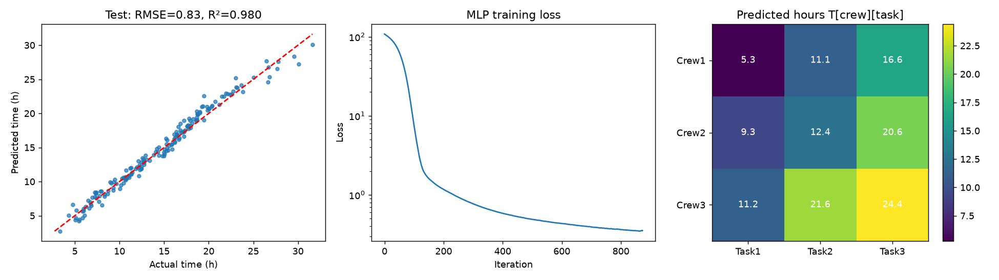
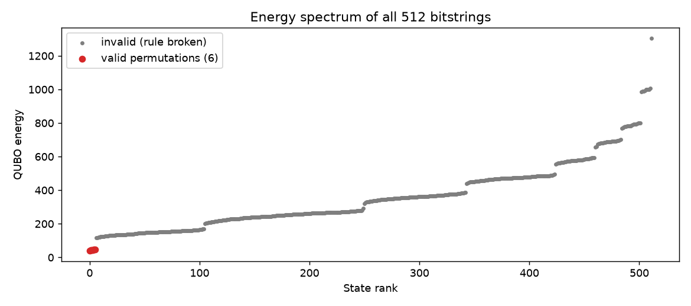
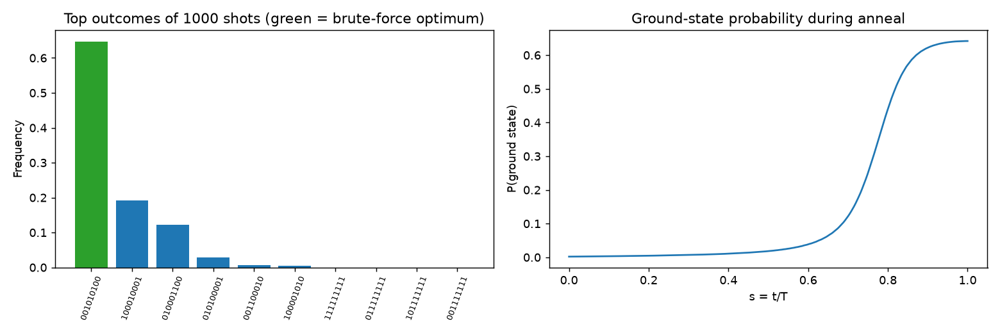
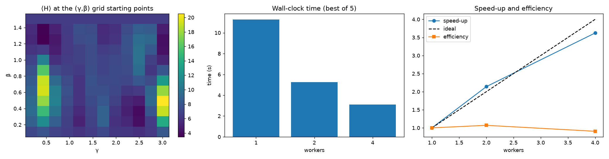

Kavya Zala 241070081 Q4 Project

# Q.4 — ML + Quantum + Parallel Computing (crew–task assignment)

Seed = **81** (from "081") everywhere. Results below are from the actual run (`outputs/run_log.txt`). See the [navigation section](#how-to-navigate-this-project) at the end for files and how to run.

---

## (a) Machine Learning (CO1)

**Data.** 600 synthetic rows (`default_rng(81)`): task_size (1–10), crew_experience (1–10 yr), travel_distance (1–50 km), tool_availability (0–1).
Time (h) = 2 + 1.2·size − 0.35·exp + 0.06·dist + 3·(1 − tool) + 4·size/(1+exp) + N(0, 0.3²).
**Model.** `StandardScaler` + `MLPRegressor(hidden=(16, 8), max_iter=3000, random_state=81)`, 70/30 split (420 train / 180 test).

| Set | RMSE (h) | R² |
|---|---|---|
| Train | 0.837 | 0.983 |
| **Test** | **0.827** | **0.980** |

Train ≈ test, so there is no overfitting.

**Predicted time (h) for each crew–task pair** (tasks of size 3, 6, 9; crews with 9, 5, 2 years' experience; distances and tool availability fixed per pair):

| | Task 1 | Task 2 | Task 3 |
|---|---|---|---|
| Crew 1 | 5.27 | 11.12 | 16.56 |
| Crew 2 | 9.31 | 12.44 | 20.56 |
| Crew 3 | 11.24 | 21.61 | 24.40 |

Crew 1 is predicted fastest on every task, so the crews compete for it and the assignment is a real decision problem.



---

## (b) QUBO (CO2)

Variables x_ij ∈ {0,1} (crew i does task j), 9 qubits, index k = 3i + j.

**Energy function**

E(x) = Σ T_ij x_ij + A Σ_i (Σ_j x_ij − 1)² + A Σ_j (Σ_i x_ij − 1)²

The first term is the predicted total time. The two penalty terms are zero only if every crew does exactly one task and every task gets exactly one crew. Penalty **A = 2·max(T) = 48.79**, so any rule-breaking costs more than any time saving.

Using x² = x: (Σx − 1)² = −Σx + 2Σ_{pairs}x x′ + 1. Hence E(x) = xᵀQx + 6A with
- Q_kk = T_ij − 2A (each variable sits in one crew row and one task column),
- Q_kl = 2A when variables k, l share a crew or a task (else 0),
- constant offset 6A = 292.76.

Q (upper triangular, rounded; saved as `outputs/qubo_Q.npy`): diagonal = [−92.32, −86.47, −81.03, −88.28, −85.15, −77.02, −86.34, −75.98, −73.19], all conflicting pairs = +97.59.

**Brute-force check over all 512 bitstrings**
- xᵀQx + 6A equals the directly computed E(x) for every state (max difference 2×10⁻¹³).
- Only 6 states are valid permutations; the best invalid state has energy 115.30, far above the valid ones.

| Rank | Bitstring (x₀…x₈) | Assignment (crew→task) | Energy = total time (h) |
|---|---|---|---|
| **1** | **001010100** | **C1→T3, C2→T2, C3→T1** | **40.24** |
| 2 | 100010001 | C1→T1, C2→T2, C3→T3 | 42.11 |
| 3 | 010001100 | C1→T2, C2→T3, C3→T1 | 42.93 |
| 4 | 010100001 | C1→T2, C2→T1, C3→T3 | 44.83 |
| 5 | 100001010 | C1→T1, C2→T3, C3→T2 | 47.44 |
| 6 | 001100010 | C1→T3, C2→T1, C3→T2 | 47.48 |

The lowest-energy state is a valid permutation and matches the best of the 3! = 6 permutations and the Hungarian algorithm (`scipy.linear_sum_assignment`): **40.24 h**. The QUBO is correct.



---

## (c) Quantum annealing, simulated (CO2)

Exact 9-qubit statevector simulation of annealing (NumPy, no hardware): H(s) = (1−s)(−Σ X_k) + s·H_problem, where H_problem is the QUBO energy (shifted by its minimum and divided by A), s = t/T. Trotterised with 4000 steps, total anneal time T = 400, start in |+⟩⁹, then 1000 measurement shots (seed 81).

| Top outcome | Shots (of 1000) | Energy | Valid |
|---|---|---|---|
| **001010100** | **647 (64.7 %)** | **40.24** | yes |
| 100010001 | 192 | 42.11 | yes |
| 010001100 | 123 | 42.93 | yes |
| 010100001 | 28 | 44.83 | yes |
| 001100010 | 6 | 47.48 | yes |

- **Best answer:** 001010100 → C1→T3, C2→T2, C3→T1, energy **40.24**, appearing **647/1000** times (exact probability 0.642).
- **Brute force comparison:** identical bitstring and energy. 99.999 % of the probability is on valid permutations.
- Longer anneals help (exact P(ground state)): T = 5 → 0.073, T = 50 → 0.242, T = 400 → 0.642. The six valid states have close energies, so the gap is small and a slow anneal is needed.



---

## (d) Parallel computing (CO4)

QAOA ansatz (p = 2 layers, same 9-qubit cost) started from a **12 × 12 grid of (γ, β)** points (144 starts, γ ∈ [0.05, π], β ∈ [0.05, π/2]). Each start is refined with COBYLA (150 evaluations) inside `joblib.Parallel(n_jobs=w)`. Machine: 24 logical cores; BLAS limited to 1 thread. Time = best of 5 repeats (median in brackets); includes worker start-up.

| Workers | Time (s) | Speed-up S = T₁/T_p | Efficiency S/p |
|---|---|---|---|
| 1 | 11.26 (11.34) | 1.00 | 1.00 |
| 2 | 5.26 (5.37) | 2.14 | 1.07 |
| 4 | 3.11 (3.22) | 3.62 | 0.91 |

- Results are identical for 1, 2 and 4 workers. Best start (γ, β) = (1.174, 0.880); the most frequent QAOA outcome is again 001010100 (energy 40.24), matching brute force and annealing, but its probability is only about 6.4 %, which is weak at p = 2 (QAOA is less effective than the annealer here).
- Speed-up is near-linear because the 144 starts are independent. The efficiency of 1.07 on 2 workers is slightly above 1; this is timing noise and cache effects, not a real super-linear gain. With 4 workers, process start-up and result transfer cost about 10 %.



---

## (e) Conclusion

1. The MLP (test RMSE 0.83 h, R² 0.98) gave usable time predictions, and the QUBO with penalty A = 2·max(T) was verified against all 512 states: the final choice is **Crew 1→Task 3, Crew 2→Task 2, Crew 3→Task 1, total ≈ 40.2 h**, even though Crew 1 is fastest at every task.
2. Simulated quantum annealing found this brute-force optimum as its most frequent answer (647/1000), but it needs a long anneal because the valid states are close in energy; QAOA (p = 2) agreed but with much lower probability.
3. Parallel joblib runs gave speed-up 2.1× (2 workers) and 3.6× (4 workers), efficiency 0.91 at 4 workers, with identical results, so the independent starting points parallelise well.

---

## How to navigate this project

### Folder layout

| Path | What it is |
|---|---|
| `README.md` | This file: answers, results and plots for (a)–(e), then navigation |
| `q4a_ml.py` | (a) Synthetic data (seed 81), Small MLP Regressor, RMSE / R², 3×3 time predictions |
| `q4b_qubo.py` | (b) QUBO energy function, Q matrix, penalty, brute-force check of all 512 states |
| `q4c_annealing.py` | (c) Simulated quantum annealing (9-qubit statevector), best answer, energy, frequency |
| `q4d_parallel.py` | (d) QAOA (γ, β) grid with `joblib.Parallel`, timing for 1/2/4 workers, speed-up, efficiency |
| `common.py` | Shared helpers (seed, QUBO builder, energies, statevector utilities) |
| `run_all.py` | Runs parts a → d in order |
| `requirements.txt` | Python packages needed |
| `outputs/` | Generated plots (`a_ml.png`, `b_energy_landscape.png`, `c_annealing.png`, `d_parallel.png`), JSON results, `run_log.txt` |

### How to run

```powershell
uv venv --python 3.12
uv pip install -r requirements.txt
uv run python run_all.py
```

Each part can also be run alone, in order, because later parts read the files written by earlier ones (`outputs/predictions.json`, then `outputs/qubo.json`):

```powershell
uv run python q4a_ml.py
uv run python q4b_qubo.py
uv run python q4c_annealing.py
uv run python q4d_parallel.py
```

Part (d) takes about 1–2 minutes because it times each worker count 5 times. Its timings vary slightly from run to run, so re-running will change the numbers in the (d) table a little.
